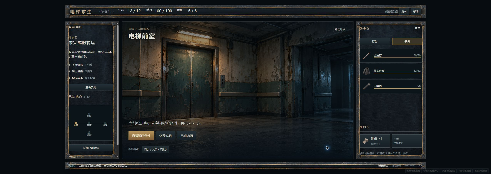

# 第一版UI R1：实际审阅入口

[122幅主稿与原型](previews/index.html) · [64件独立素材](previews/asset-gallery.html) · [25族状态表](02-page-state-matrix.md) · [修前/修后与实际QA](validation/r1/review-notes.md)

本轮修复独立样例与连续操作混用、查看重置异常/死亡上下文、对象菜单错绑、三敌退却地点、采样支付遗漏和防御演出含义。122张主稿及47张补充视口重新导出，另有九宫格同状态对照。沿用外围常驻＋中央可放大方向；没有生产实现或玩法变更。

**状态：REVIEW CANDIDATE / INCOMPLETE_ART，不标COMPLETE。** 大舞台原生2×仍不足；透明边缘只部分改善。file协议实开仍NOT VERIFIED。九宫格整体缺框已修复，但导出滚动条覆盖、抗锯齿及JPEG压缩与原生截图仍不同；以浏览器实际渲染为唯一权威。

实际100%/125%/150%缩放已经在Owner的2560×1080屏幕上验证。CSS视口分别2552×908、2042×726、1701×605，DPR分别1/1.25/1.5；已恢复100%。它们与47个模拟视口导出分别留证。

推荐先看重点包中的初选到出发、五图地图、三敌退却、样本菜单/移动、八种支付、战斗动作和缩放/九宫格截图；再看完整图稿、可编辑母版及独立素材。重点包不能替代两完整ZIP。精确名称、大小、摘要见[交付清单](spec/delivery-packages.json)。

可编辑母版为HTML/CSS/JS与逐页SVG；不伪称Figma原生文件。原型只表达设计上下文，不读写profile、存档、真实CTB或生产来源。历史QA保存在validation/history-v1.0，旧结论不计作本轮通过。

新增Owner建议已记录：[缩小常规弹窗](reviews/OWNER-modal-size-followup.md)。本轮不改已导出尺寸；600×360是后续参考，不能机械套用全部内容层。

待联合审阅：修复语义、实际视觉/素材质量，以及后续公开CTB演出与敌人展示键的[交接草案](06-implementation-handoff-draft.md)。无新增玩法采纳请求。等待准确SHA实文件联合复审，不进入生产工程、O3或音频。
