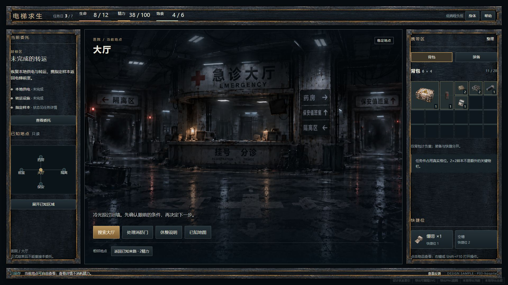
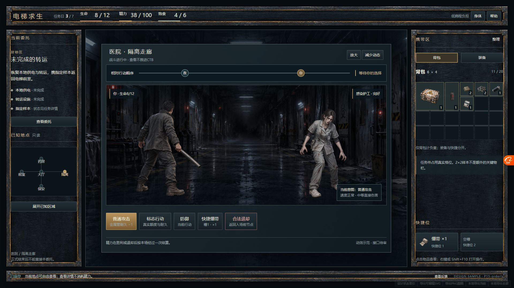

# 第一版UI：实际审阅入口

[打开全部113幅主稿](previews/index.html) · [点击／战斗动效原型](prototype/index.html) · [63件独立素材](previews/asset-gallery.html) · [页面状态表](02-page-state-matrix.md)

本轮沿用外围常驻＋中央可放大方向，实际制作25个页面族、113个1920×1080状态、42幅补充视口图、可编辑HTML/CSS/JS母版与逐页SVG。24节点、19种当前实物、三敌五阶段、玩家与两NPC、关键节点及独立命中FX均有图像绑定。所有画面都是设计样例，不是生产运行截图或规则模拟。

**交付状态：可审阅的设计候选；完整验收仍为 blocked / INCOMPLETE_ART。** 大背景原生约1672×941，未达到大舞台2×要求；真实125%／150%浏览器缩放未核验；组件PNG导出的九宫格边框与原生浏览器存在渲染差异。没有用插值放大、CSS缩放或历史测试冒充通过。

## 推荐的审阅顺序

1. P01工具与专长、P03五图、P04跨区：判断中央场景和外围信息密度。
2. P06任务节点、P08样本四态、P10／P11真实格位：判断明确参数是否清楚。
3. P15三敌、P16放大／五阶段／命中／减少动态：看实际动效原型，不以静图代替。
4. P18—P24四终局、静态中枢、保存／锁／坏档：确认没有重接、复活或假默认记录。
5. [尺寸与裁切](03-dimension-contract.md)、[QA](validation/design-qa.md)、[实际文件检查](validation/final-check-results.json)。

## 本次需要联合审阅的少量事项

- 版式、独立人物／NPC外观、五图共同质感和战斗站位是否接受为后续美术方向；不重开玩法。
- 高清背景仍须补足；当前图可评构图，不能冻结为满足DPR2的生产原稿。
- 更细CTB演出与敌人展示键缺安全读取接缝。这里只给[接口交接草稿](06-implementation-handoff-draft.md)，不读取私有敌人数据、不修改Schema。
- SVG含foreignObject与独立相对图像，HTML/CSS是主要可编辑母版；没有Figma原生文件。包内相对依赖齐备；file协议实开被工具安全策略拦截，未核验。作者PNG再导出需启动本目录的loopback导出服务。

两个ZIP的确切名称、大小、摘要见[交付清单](spec/delivery-packages.json)。它们是实际文件，不是云端发布。停止在主线与Owner联合审阅，不进入生产实现、保存、O3或音频。
