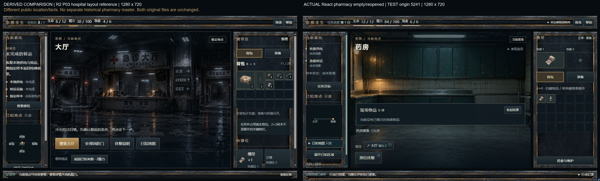
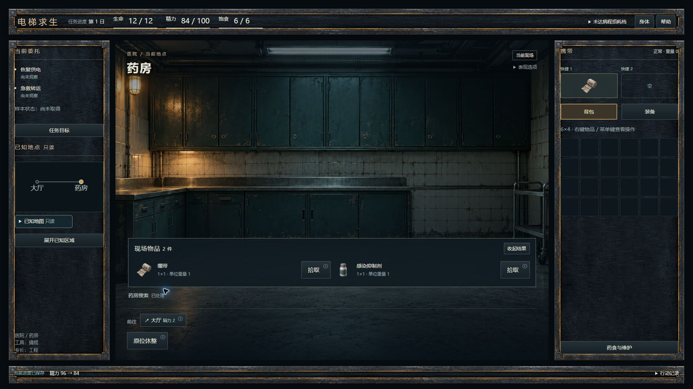
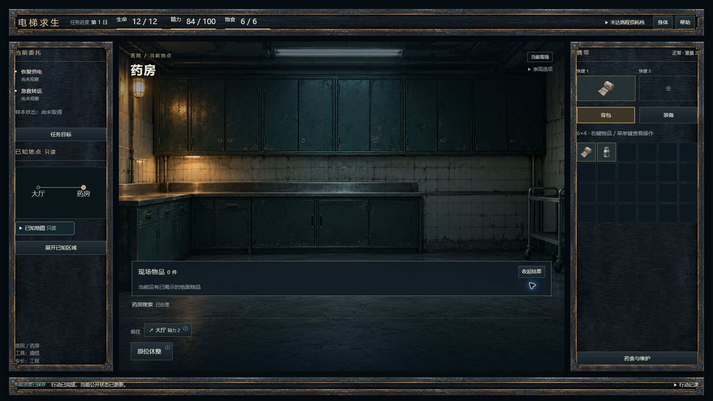

# M1：R2 主壳、真实场景与搜索

本文件是工程检查点。M2、M3 连续进行，整体任务尚未完成，Owner 试玩仍暂停。

## 真实画面

目标为 `docs/design-drafts/ui-v1-001/prototype/ui.css` 和 `previews/screens/P03-hospital-1920x1080.png` 的 R2 探索框架，配清单中的 `bg-h2-v1.png`。历史稿没有独立 P03-pharmacy，不能声称有逐像素相同的药房原稿。实际任务事实、物资与数值来自正式 view，不复制主稿样例。

原生链：新 TEST origin 的 Setup → 初次中枢 → 电梯前室 → 大厅 → 药房 → 无照明搜索 → 实际绷带/感染抑制剂 → 两次明确拾取 → 取空 → 收起/重开。截图 03 属于第一次自查，之后移除未搜索空框和非战斗空反馈行；04/05/06 为后续修正画面。M3 会在最终界面重拍主流程。

五档壳尺寸已由实际 Edge DOM/原始截图记录：1920、1600、1440、1366、1280；中栏分别为 1200×888、968×728、856×744、814×620、768×584。原图未补边、缩放或拼接；尚不据此宣布 M2/M3 页面视觉通过。

## 实装

- 原 DEV 入口直接使用新三栏；左任务与只读局部拓扑，中间当前场景，右真实携带，底部同源反馈和可展开 Feed。
- 全部 46 图逐字节、SHA256、Git blob、PNG 原生尺寸校验：35 张准确复制，11 张复用已有相同运行资源。旧 catalog、原图、15 张敌图不改。
- 24 个地点只按公开 place/name 封闭绑定；独立 Hub 不与医院电梯前室混用。背景只请求当前场景，失败隐藏当次图片，未知绑定中性回退。
- 搜索、拾取、first-fit、Opaque 请求、保存仍委托原入口。结果区只读当前 ground；取空和重开不搜索、不造物。
- 身体、任务、地图、帮助是内容层，参数与保护仍使用原请求入口。普通聚焦/悬停不再弹大说明；显式说明或 F1 仍查询原正式事实。
- 非战斗无 cue 时只保留折叠表现选项，不显示空跳过栏；C1 hook/consumer/token 与 C2 loader/registration 均未改。

## 实际检查与迁移

开工默认 `npm run test:run`：343 文件 / 4929 项通过，387.13 秒。`npm run typecheck` 已通过。

M1 首轮定向 3 文件 / 91 项通过；说明与键盘相关组合 5 文件 / 100 项通过。完整 UI 首轮 36 文件 / 301 项发现 7 个旧呈现断言问题，修正后针对 3 文件 / 21 项通过；后续完整 UI 300 通过、1 个状态节点次序问题，已移除无内容节点的 status 语义，相关保存文案及 C1 原生集成 2 文件 / 13 项重跑通过。原始失败和修复日志均保留，未把分批或重跑项相加冒称单轮全量；最终全量由 M3 完成。

旧测试窄适配：显式 F1/说明代替自动弹层，药食参数取消返回仍存在的来源层；已批准撬棍正向显示并验证坏图回退；仅从原整 DOM 中文检查排除两个已批准公开图片 URL，其他文字、属性及隐私正则继续检查。所有提交、读写、随机、失效和死亡断言保留，无删除/skip。

## 基线与边界

- Base：`c5abeda4861710325a123e8321a314423525f8df`；base tree：`7b97cd88523255a737fe406974b78de247672f57`。
- 分支：`feature/world-ui-v1-integration-001`。开工工作区/索引干净，未 stash、清档、移动旧分支或 baseline。
- 包在仓库外验证并解压；原包 124496 字节，SHA256 `cc6a5714737b10b7338a888713bc95ae29b7c07b173298358cbb7df26345e687`。包中没有 verify-package.py，未声称运行该文件。
- 推荐 GPT-6.1 Sol/high/Standard；会话工具未暴露实际模型、effort、service tier，记录 UNCONFIRMED，不声称切换配置。
- Browser：本任务重新取得仅 5241 本地标签许可；未读其他标签、改 profile 设置或访问 5233 Owner 数据。只运行一个本任务所需 Vite 服务，定向测试限制为两 worker。
- 玩家素材、B2、最终清稿/背景 2×及 Owner 审美认可继续保留。M2 携带/信息层与 M3 战斗/异常/最终回归仍在进行。
