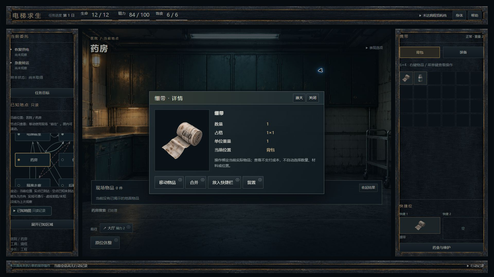
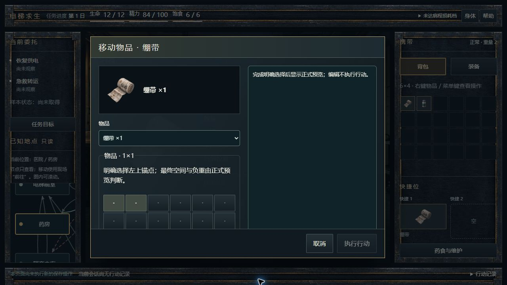
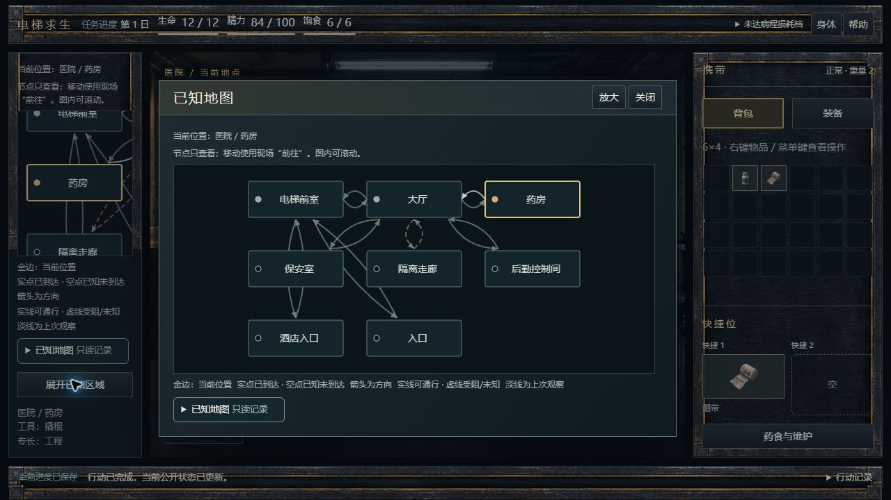
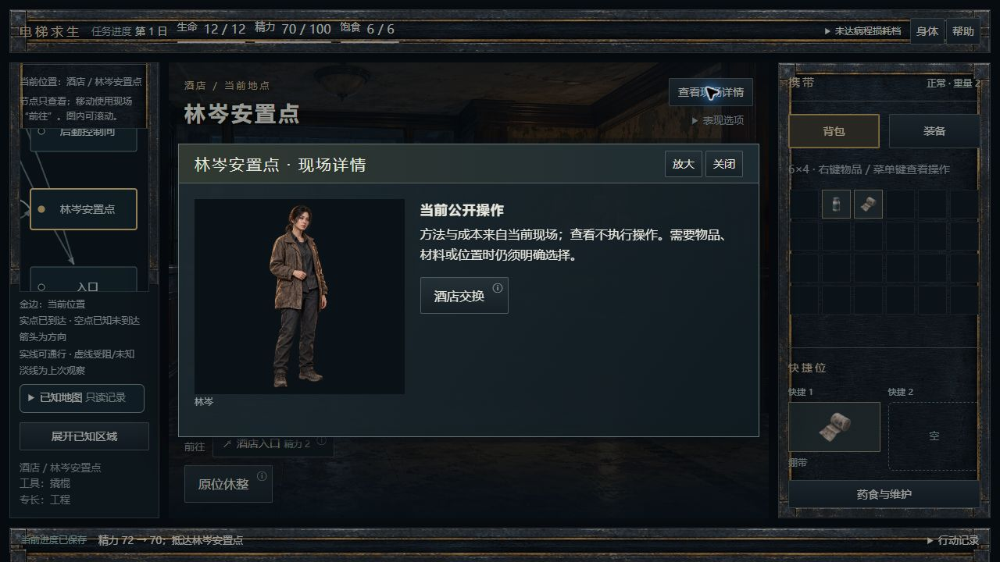

# M2：真实携带、内容分档及 Owner 地图补充

目标：[R2 物品详情主稿](../../../design-drafts/ui-v1-001/previews/screens/P10-detail-pipe-1920x1080.png)。实际图展示本次真实绷带，字段、数量及位置与设计样例不同；680 宽内容层及真实 6×4、两快捷位沿用 R2 空间结构。局部材质与标题层级还会在 M3 视觉自查修订。

## 接线

- 地面、背包、快捷、装备、详情及参数使用同一个物品图片组件和封闭19图绑定，component/module 的公开中文名与图片同源。旧错误回调只影响其原 URL，不能替换当前物品。
- 左键/Enter 查看实际物品；右键、菜单键、Shift+F10 仍打开原操作菜单。详情保存当前 opaque 引用，失效关闭而不按标签找替身。原数量/材料/格位/旋转/维护池与正式 Preview 未改。
- 快捷区移到携带栏底部，装备就地操作仅来自 describeAction 对该实际物品的候选；只读战斗不添加携带命令。
- 详情680、参数880、复杂整理1000、摘要800、地图1040均受中央区限制，参数正文局部滚动、执行/取消固定可达。NPC与近景仅绑定当前公开互动，不新增话题、交换或知识。
- 原生链已实际完成药房拾取后从详情打开移动参数，明确选择第三列第一行，正式预览0精力，执行后真实格位 `1 / 3 / 2 / 4`；再从 Travel Cluster 到酒店和林岑安置点查看既有互动。

## 地图追加

按 Owner 本轮补充改用纯 UI 内联 SVG。小图和展开图使用同一完整 map 投影，包含全部已知节点和全部有向边；反向边、环路、当前/上次观察、可通/受阻/未知均保留，不化成树、不查静态全地图。小图使用有界滚动保持14px文字与可聚焦节点；展开图提供相同拓扑和文字记录。节点点击/Enter仅显示公开记录，移动仍由原 Travel Cluster 完成。

## 实际验证

- M2 原 UI 迁移回归：36 文件 / 301 项通过。
- 新地图、物品及原只读边界组合：4 文件 / 14 项通过。
- 最后定向：3 文件 / 12 项通过；typecheck通过。分批不相加为单轮全量；M3继续组合/E03/default check/CI。
- 循环与反向边、节点状态、未知节点不提前出现、相同安全数据、节点/键盘/展开零dispatch/写入、新旧图片回调、实例迁移一次等均有新测试。
- Edge原生已验证详情两档、真实参数、节点键盘查看与展开图、非医院及既有NPC。开发期热更新曾令新Context不匹配；保存后真实冷恢复正常，未清档或重放动作。最终证据在冷页采集。
- 普通1920截图有一次返回1920×683，`10-item-detail-1920.jpg`记PARTIAL并原样保留；改用工具已支持的fullPage后，`12...jpg`真实1920×1080，1280原图也完整。未修图补边。CSS zoom=1不是浏览器真实缩放验收。

M1提交：`f46159f8c97e08adb324b2e1efcf6a657dc078a2`。本检查点继续M3，不邀请Owner试玩；真实zoom、系统媒体reduce=true、390及整套视觉闭合仍据后续实际证据分账。
