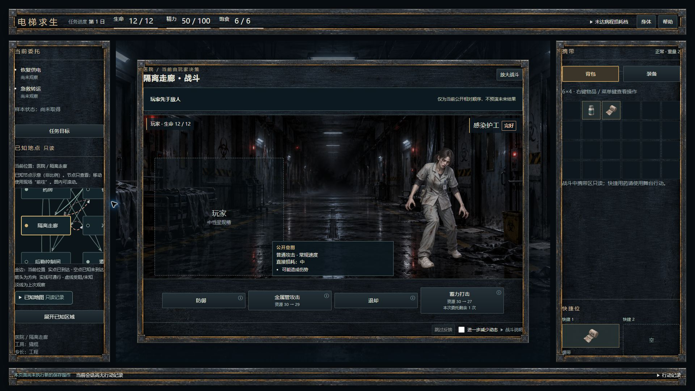
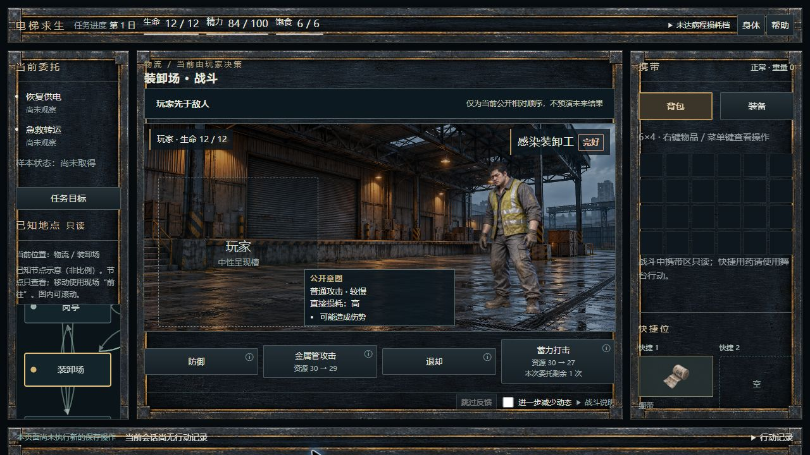
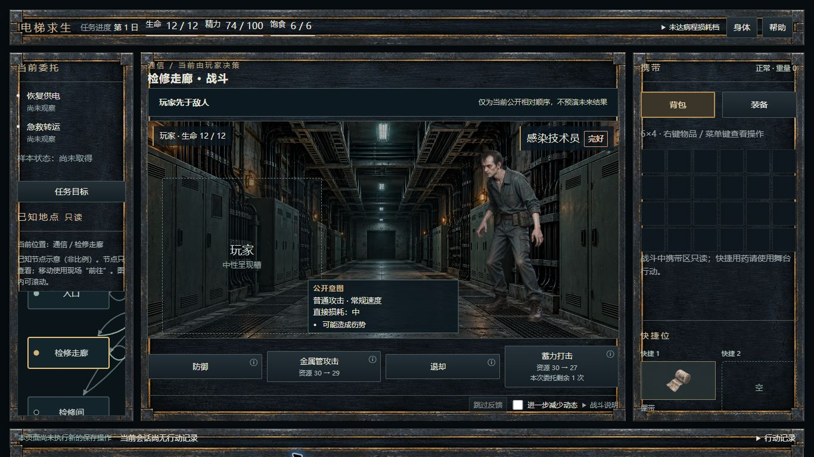

# M3：真实战斗空间、终局与整体验证

以 R2/v1.2 的主壳、分行预算和战斗画布为目标。普通/放大切换只改本地展示；1920普通舞台1080×780、画布高452，1280/1366自动使用可用中央空间。三敌仍由正式 A 当前对手及原 C2 整组 loader 选择，阶段、注册位置、组代、错误及旧回调语义不改。玩家继续中性槽；没有接原型玩家图、B2连续CTB或逐击披露。

原B1直接结果/C1消费者移入舞台底行，四至六个真实动作、当前资源和次数来自正式view。场景图层不锁动作。非战斗反馈折叠且无空白跳过条。Setup、系统状态、参数/信息/保护层使用同一既有材质；所有提交、确认、保存及错误逻辑保持。

## 实际结果

- 组合含原E03：147文件、1328测试通过；定向战斗/C1/C2组合3文件19测试通过。定向不是最终全量的替代或相加。
- 三类语义负控均真实触发 AssertionError、exit 1，finally恢复原字节：药房错图、stale详情替身、只读地图冒发移动。
- 首次默认检查348文件中5失败：新场景plate令旧的“全部战斗img”断言失效。仅将两文件各两处选择器收窄至敌人raster；pending/failed无敌图、ready必须有敌图、提交/保存/B1及退出断言均保留。
- 恢复后原默认 `npm run check` 成功，348文件/5024测试；架构、类型及build成功。仅环境变量 `VITEST_MAX_WORKERS=2` 控制本机并行，不改脚本、选择集、依赖或CI。
- 正常空TEST origin连续链已走到首场护工。原生另用正式生产者和严格codec生成的冷样本补装卸工/技术员、后期2×2携带、成功、死亡及失败生还。
- 真实敌组HTTP503时中性回退，防御照常生效并成功写一次；真实checkpoint写入故障时显示“操作已生效，尚未保存”，跳过/本地减少动态不写，重试只多一次成功保存且未新插入反馈，冷恢复0写/0反馈插入。
- 390×844取得原生全幅与携带键盘抽屉；Escape恢复携带按钮，地图Enter/关闭恢复原入口，累计checkpoint写入保持7。系统媒体true与真实zoom仍NOT VERIFIED；Owner试玩NOT RUN。

最终本地检查与原图已完成；准确提交/parent/tree、push及该SHA CI由提交后的外部最终回执报告。不得将本文提交前的CI状态冒称已经成功。
