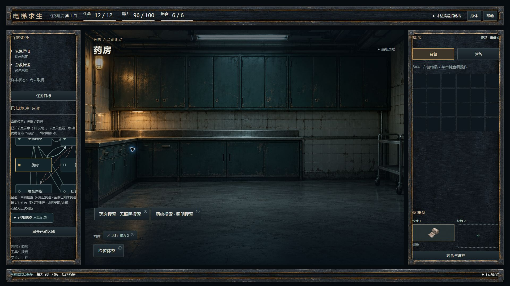
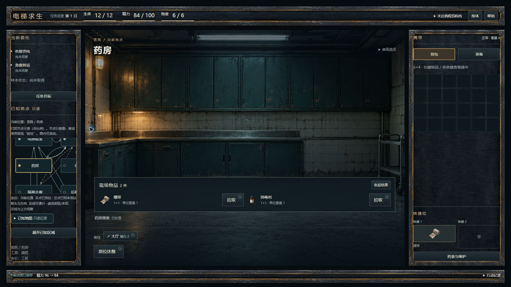
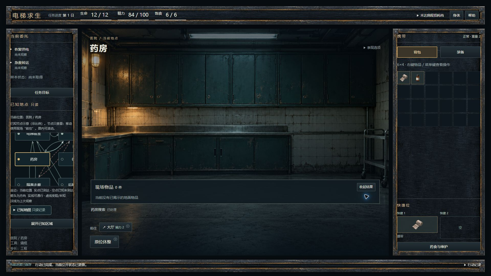
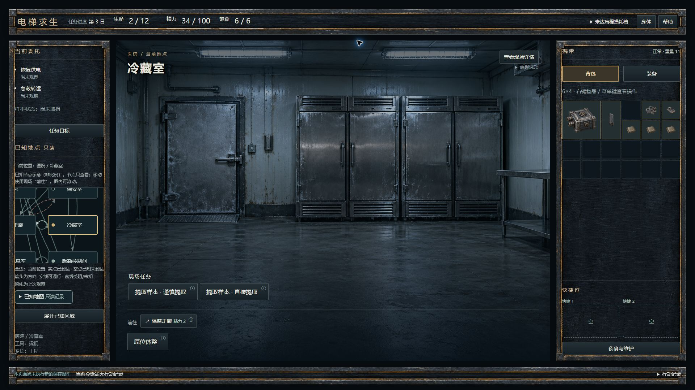
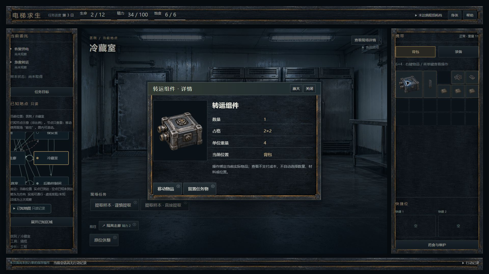
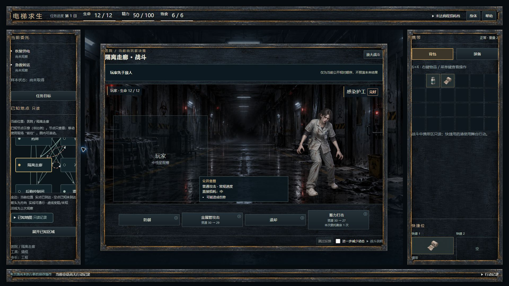

# ENG-WORLD-UI-V1-INTEGRATION-001 — 主线代码与视觉审查

新版界面已直接接入原 `?dev-infected-world=1` React入口。下面均为实际运行原图；原稿只提供空间/视觉目标，真实游戏数据来自正式查询。

## 先看药房、携带与战斗

[1280未搜索原图](evidence/29-final-pharmacy-unsearched-1280.jpg) · [1280取空原图](evidence/32-final-pharmacy-empty-reopened-1280.jpg)。本轮实际发现绷带/消毒剂，搜索精力96→84，逐件拾取后进入真实6×4；重新查看无再次搜索、支付或生成。首轮连续链中发现的另一组合以当次真实产出为准，没有固定结果来摆图。

[1280物品详情完整原图（M2）](evidence/11-item-detail-1280.jpg) · [真实格位参数](evidence/13-real-placement-parameters-1280.jpg) · [展开只读地图](evidence/14-known-map-1280.jpg)。实际物品、尺寸、资源、背包位置均来自当前实例，设计稿的示例数字没有复制进游戏。M3把详情标题与材质修订为当前22图；M2原图保留其实际阶段。

[护工1280正常连续链](evidence/16-natural-orderly-battle-1280.jpg) · [装卸工1280](evidence/18-porter-1280.jpg) · [技术员1366](evidence/19-technician-1366.jpg) · [真实敌图503回退仍可行动](evidence/23-actual-enemy-network-failure-action-1280.jpg)。后两敌及异常补验使用下述合法TEST冷样本，未冒称都由同一普通新档连续走到。

### 与R2/v1.2母版对照

| 场景 | 设计目标 | 真实接线与允许差异 |
|---|---|---|
| 主壳/搜索 | [P03医院主稿](../../../design-drafts/ui-v1-001/previews/screens/P03-hospital-1920x1080.png) | 同一五档三栏/HUD/中央/底栏空间、既有材质与真实背景。药房没有独立历史母版，不虚构P03-pharmacy。未知前无空结果板；揭示后紧凑结果板。 |
| 携带/详情 | [P10详情](../../../design-drafts/ui-v1-001/previews/screens/P10-detail-pipe-1920x1080.png) | 680级内容层与图片/事实/实物操作分区。原稿管子样例变成当前绷带/2×2组件，真实数量、重量和资源保持。 |
| 战斗 | [P15护工](../../../design-drafts/ui-v1-001/previews/screens/P15-orderly-1920x1080.png) | 1920正常1080×780、头/公开相对顺序/452高画布/真实动作/反馈分行。玩家图延期，中性槽；相对顺序只显示正式枚举，不模拟CTB。B1反馈不扩为B2演出。 |
| 地图 | Owner本轮追加 | 小图与展开图共用全部正式map节点及有向边，保留环和反向边，不采用原稿树形节选。图内滚动保14px文字，移动仍在Travel Cluster。 |

自查修订包括：删除自动焦点/悬停大解释、未搜索空板和非战斗空反馈条；修正图层尺寸被旧12rem压小、战斗背景被面板遮盖、详情标题/边界、内容层键盘summary覆盖。原始早期02/03图和工具返回的10图不充作最终通过证据；10为1920×683 PARTIAL，原样保存，另由工具fullPage取得12图真实1920×1080。没有补边、裁拼或缩放冒充原图。[全部像素/字节/SHA索引](evidence/captures-all.json)区分原图和唯一明确标记的派生对照。

## 起点、工作包与改动

- 仓库 `lvlw/elevator-survival`；BASE `c5abeda4861710325a123e8321a314423525f8df`，tree `7b97cd88523255a737fe406974b78de247672f57`。
- 仅工作分支 `feature/world-ui-v1-integration-001`；本报告所在提交为M3检查点。最终完整SHA/parent/tree及push/CI在提交后的最终回执中给出，以避免自引用SHA。
- M1 `f46159f8c97e08adb324b2e1efcf6a657dc078a2`，parent为BASE，tree `9062007b926f3e526fa74850c8f54131da4b5ba2`。[M1报告](M1.md)。
- M2 `ac98a2bac0fe2b728783c5b1d8a20e4777f6b412`，parent为M1，tree `882014c02a0ee0340e384f4683e495af6879faff`。[M2报告](M2.md)。
- M3完成战斗、整体内容层/系统一致性、实际浏览器、自查及负控后的默认全检。[M3报告](M3.md)。
- 实际工具环境：Windows/PowerShell、Node24.9.0、npm11.6.0、React19.2.8、Vite8.1.5、Vitest4.1.10。推荐Sol/high/Standard；接口未提供具体实际型号/推理档/服务档，三项均 **UNCONFIRMED**，未宣称已切换。
- 包在仓库外解压。ZIP SHA256 `cc6a5714737b10b7338a888713bc95ae29b7c07b173298358cbb7df26345e687`，124496字节；验证安全路径/CRC及manifest十项载荷。包没有verify-package.py，未声称执行不存在的脚本。[原授权与输入](inputs/README-FIRST.md)、[验证回执](inputs/verification-receipt.json)及Owner地图追加均保留。

运行改动集中于 `src/ui/infected-world/`：主壳/GameShell、WorldStage、Inventory/ItemTile/ItemInspection、共享ContentLayer、ActionForm/Confirmation展示、TaskArtwork、HUD/Setup/System、BattleStage、CommittedActionCue与新增UI CSS/五个新测试文件。`app.tsx`仅增CSS和战斗展示prop，原guard/preview/confirm/execute/single-flight保持。35张既有PNG准确复制，11张相同旧runtime图复用，合计46候选；三敌15张沿用。[逐图来源、原生尺寸、blob及SHA](adopted-assets.json)。没有生成、修复、放大、改alpha或采用玩家图。

## 页面族接线闭合

| 页面族 | 新运行组件 / 正式来源 | 已跑用例与证据 | 边界 |
|---|---|---|---|
| P01/P02 | SetupPanel、GameShell、WorldStage；原setup/first-hub view | 原setup/entry测试、空origin真实创建与进入；01、27图 | 初配全空，必须明确选择；未替Owner创建。 |
| P03/P04/P05 | WorldStage、原Travel/ActionButton/地面对象；location/interactions/ground | 强制药房全链28—32、五档06—09/28、原longchain与E03；非医院15/18/19 | 24公开地点封闭绑定；未知地点不加载图片。 |
| P06/P07/P08 | TaskArtwork、原参数/指定任务物确认；当前地点及当前公开方法 | 原parameters/confirmation-stale/longchain/E03；林岑真实15、火门参数/作业连续链；周衡既有链DOM | 两NPC及6近景已接原动作。周衡没有单独原生照片；未新增交易/话题/规则。 |
| P09/P10/P11 | KnowledgeMap、Inventory、ItemInspection、ActionForm；正式map、opaque实例与preview | 新map/items、原inventory/first-fit；14、21/22、13、390抽屉34；实物移到第三列第一行 | 所有边保留；查看0dispatch/保存。失效对象关闭，不能找同名替身；整理不自动执行。 |
| P12/P13/P14 | 原药食/维护/充电ActionForm和休整预览，公共身体/真实资源 | 原medical-maintenance、parameters、phases/E03回归；新右栏原入口可达 | 不改药效/维护池/成本；日后果与死亡断言保留，未逐项原生重拍。 |
| P15/P16/P17 | BattleStage、原EnemyArt、原C1消费者；A/B1直接结果及现有C2 | 三敌16—19、真实503图23、C1/C2/lifecycle/战斗新旧集成；普通/最大本地切换0写 | 无逐击/B2/假相对CTB；失去能力不宣称死亡；加载不锁动作。 |
| P18/P19/P20/P21 | 原终局摘要与GameShell；正式结算/strict cold codec | 原terminal/combat/E03完整；实际生产者样本成功24、HP0死亡25、止损生还26 | 截止失败在原DOM回归，未单独浏览器截图；没有续局或自动治疗。 |
| P22/P23/P24/P25 | 原保护/错误/保存入口＋ContentLayer/SystemScreen；原BrowserOwner/安全查询 | 原faults/browser-binding/confirmation-stale/accessibility/information-purity；真实保存故障20、retry/冷恢复、Escape/F1、390 | 占用/坏档/读取异常是原生产逻辑DOM回归，没有编造原生截图。 |

## 实际测试、迁移和浏览器

[原始日志（42条，base64保留原字节并附SHA）](evidence/raw-logs-final.json) · [结构化检查账](evidence/validation-summary.json) · [负控回执](evidence/negative-controls.json)。M1/M2阶段日志也各自保留。每轮独立报告，定向/组合不与默认全量相加。

| 轮次 | 实际命令/结果 |
|---|---|
| 开工基线 | 原 `npm run test:run`，343文件/4929项PASS，387.13s。 |
| M1/M2 | M1定向与旧DOM修订；M2原UI36/301、新地图/物品4/14、末定向3/12及typecheck通过，详阶段日志。 |
| M3相关组合/E03 | `npm run test:run -- --maxWorkers=2 src/ui/infected-world src/app/infected-preplay src/app/infected-browser src/state/residence-session src/content/infected-world-v0.1/acceptance`：147文件/1328项PASS，466.14s。 |
| M3战斗定向 | 新战斗与原C1/C2组合3文件19项PASS；正式样本生产probe另1文件1项PASS，15.02s。 |
| 首次默认检查 | 348文件，5019PASS/5FAIL，原因是新增场景plate与旧全img选择器冲突；原日志保留。 |
| 最终默认检查 | 原 `npm run check`：架构53 DEC/347 core文件PASS，typecheck PASS，348文件/5024项PASS（678.09s），build PASS（425模块）。exit0。仅 `VITEST_MAX_WORKERS=2` 限并行以应对Owner电脑资源反馈，未改默认选择集/脚本。 |
| 准确SHA CI | 提交前尚未运行；普通push后查询该提交Actions/job并随最终准确SHA回执报告。本地通过不冒称CI。 |

旧测试迁移均窄适配：焦点不再自动弹大层而以F1/ⓘ查看；携带/药食移动到内容层后的焦点入口；既有批准图出现与坏图回退；公开文案检查仅排除两个批准资产URL中的英文文件名，文本/aria/title及隐藏字段断言继续；C2四处全img选择器改为敌人raster。未删除、skip或放宽提交、保存、隐私、实例失效、保护、死亡断言。新增95项，默认总数4929→5024。

三负控分别把药房图指向大厅、stale详情退回第一携带物、只读地图点击派发移动；都产生业务断言失败，exit1，finally恢复字节及SHA后再跑默认check。负控不写core/存档/expected/refs。

浏览器为新确认范围的现有Edge，仅本次 `127.0.0.1:5241` 标签，不读其他标签、不改profile/OS、不碰Owner5233。M1从空独立origin用正常原入口走Setup→药房→逐件拾取→真实格位参数→酒店NPC→火门作业→首战。后续TEST驱动仍运行原index/main/React/BrowserOwner：其fixture由[真实DOM生产probe](browser-records.probe.ts)及严格codec产生，[17个原输入](evidence/browser-records.generated.json)记录来源；没有手写HP或背包摆图。

[TEST-only Vite观察驱动](browser-test.config.mjs)仅该loopback端口：非空未标记origin拒绝改写；显式fixture冷启动或已知M1/M2 origin接管。一次checkpoint异常和敌PNG HTTP503只为故障补验，未修改生产实现；没有覆盖Image/decode/matchMedia/时长。公开DOM逐帧metadata/HTTP请求在原始日志归档；非空反馈span插入计数只表示DOM插入，不冒称全生产token日志。仪器页head含TEST fixture，**其整页DOM不用于非干涉证明**；隐私由正常UI整套DOM的新旧非干涉与公共变化正控验证，M1/M2正常入口原图佐证。

真实原生关键计数：连续三次防御均完成，一次点击完成后可继续下一动作，不等待反馈；保存故障一尝试/一失败、反馈插入1，跳过/本地减少动态与retry后两尝试/一成功/仍插入1，冷恢复0写/空反馈/0插入；真实503时防御一成功写入且有B1反馈；本轮药房七次checkpoint写入成功，重开结果、只读地图/抽屉及Escape后仍七次。未让Owner代验收。

### 五桌面档与390

| CSS viewport / DPR1 | 左 / 中 / 右宽 | 中央高 | HUD / footer | 原图 |
|---|---|---|---|---|
| 1920×1080 | 280 / 1200 / 360 | 888 | 72 / 40 | 28、17、21/22；均完整1920×1080 |
| 1600×900 | 240 / 968 / 320 | 728 | 64 / 36 | 07完整1600×900 |
| 1440×900 | 224 / 856 / 304 | 744 | 64 / 36 | 08完整1440×900 |
| 1366×768 | 208 / 814 / 288 | 620 | 60 / 32 | 09、19完整1366×768 |
| 1280×720 | 192 / 768 / 272 | 584 | 56 / 32 | 29/32、11、16/18、13完整1280×720 |

药房、携带详情、战斗三核心均有两档真实完整图；阶段与最终修订如上明确。布局没有缩放整个UI或靠整页滚动挤入桌面，信息/参数正文、小地图在各自容器滚动。

[390×844真实全页](evidence/33-390-native-pressure-fullpage.jpg)及[键盘携带抽屉](evidence/34-390-carrying-keyboard-drawer.jpg)为本轮代表压力档；HUD自然换行，中央/可关闭抽屉可达。Enter打开携带、Escape关闭后焦点回携带；地图关闭回展开入口，0额外写入。它不等于完整移动版或历史C16全面收口。系统媒体reduce=true、真实浏览器zoom仍 **NOT VERIFIED**；未重复不支持的接口、未用CSS视口冒充zoom。Owner体验 **NOT RUN**。

## 验收、保护与停止点

| 矩阵 | 状态与证据 |
|---|---|
| U01—U06 | PASS：准确base/原入口、五档主壳、强制药房链、24地点、46准确字节/15敌图、真实携带实例与参数。 |
| U07—U09 | PASS（原生/DOM分账）：Shift+F10真实菜单、Escape焦点、readonly0写、原L1/L2/L3/医疗与任务NPC链；未重拍的NPC/充电等已明确。 |
| U10—U13 | PASS：三敌新预算、真实503、原C1/C2失权/迟到/旧timer回归、真实保存故障/retry/冷恢复。 |
| U14—U15 | PASS（DOM与代表原生）：正式终局/异常逻辑与整套新DOM隐私；没有把TEST头部夹具用于隐私结论。 |
| U16—U17 | 五档桌面及本轮390代表压力/键盘PASS；系统媒体true/真实zoom为NOT VERIFIED，C16历史结论不覆盖。 |
| U18—U19 | 运行只读正式view，无SCREENS/flow-context/样例数字进入runtime；三负控与最终默认PASS，准确CI待提交后回执。 |
| U20 | 本报告/原图/差异已交，Owner仍暂停。Git最终SHA与远端保护以提交后回执为准。 |

[范围/精确源/refs预提交审计](evidence/final-scope-precommit.json)由[只读审计脚本](final-audit.py)产生：71个旧本地项目refs及旧远端refs无变动，宿主内部refs仅观察；冻结运行路径保持，特别记录包列出的 `entry.ts` 在BASE与checkout均不存在，其余八个冻结文件blob相同。旧原图/catalog/生成器、core/S/current、协议、保存/expected、BrowserOwner、根入口、依赖/CI、正式规则/设计记录均未改。仅新分支普通提交/push，不合并、不强推、不发布。

本地自查视口已reset，工程测试页已关闭，5241服务停止（最后只剩TIME_WAIT，未停其他工具进程）。保留本轮隔离TEST证据，不清Owner数据。没有遗留已知规则/授权冲突；输入中的不存在冻结路径已如实记账。

仍保留玩家v2、最终清稿/透明边缘、背景2×、B2、真实zoom/媒体true及Owner体验门槛。没有把这些当理由推迟本批主壳/46素材/战斗工程接线。交付到主线准确SHA代码与实际视觉实审后停止，不邀请Owner试玩、不继续新玩法/素材/部署/发布；不重复源码ZIP或全仓对象清单。
