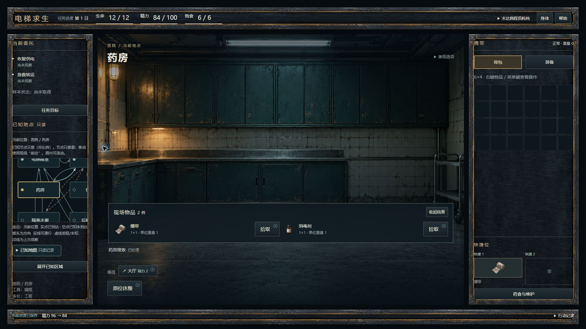
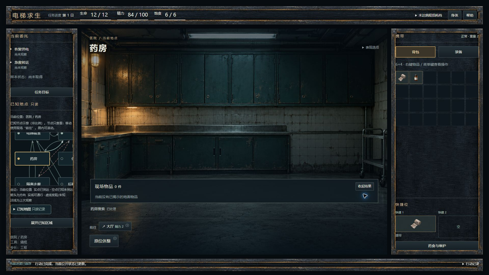
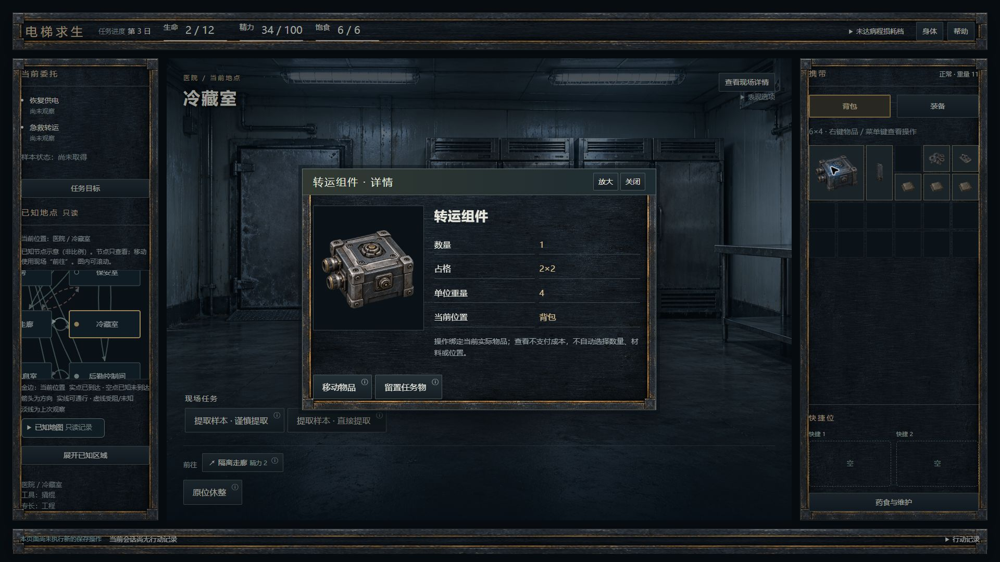
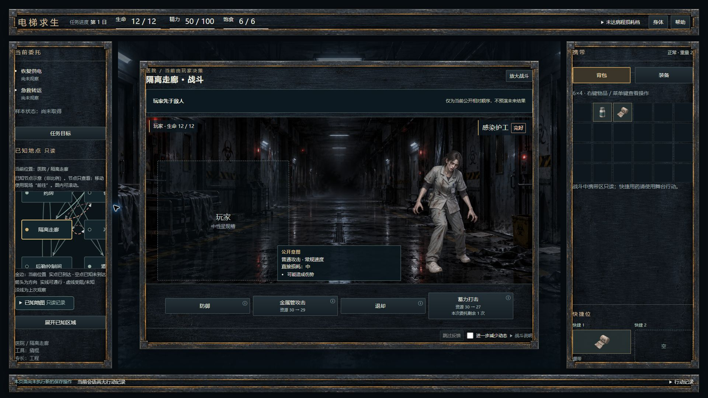

# ENG-WORLD-UI-V1-INTEGRATION-001-R1

仅修复药食/维护层的失效生命周期与地图歧义全名绑定。保留全部M1—M3、CSS、布局和资源；没有重新设计或铺视口矩阵。Owner试玩暂停，最终提交交主线代码与原图复审。

## 四张既有主桌面原图

[VISUAL-ONLY.zip](VISUAL-ONLY.zip) **只含TASK指定四张原JPG**，可下载后直接转交主线；[来源与逐图SHA清单](VISUAL-MANIFEST.json)。均来自 `ba865ea05cedac84d661969992683349cca7a519`，1920×1080，逐字节核对该提交Git blob。不是R1重拍，没有源码、素材库、补边或修改像素。

ZIP 1,080,736字节，SHA256 `46718f48408c1f9570a18ab09467862beed5f892e8b5a62550ffedf35ac16075`。它是视觉附件，不是源码交付。R1新增终局浏览器截图 **NOT RUN**；本轮未启动浏览器会话、测试服务或接管日常profile。行为证据是下述真实React DOM/正式生产者回归，不冒充原生浏览器像素。

## 准确起点与输入

- BASE `ba865ea05cedac84d661969992683349cca7a519`；tree `7d34277c26ce2d3990fcd9568a6d48693378041a`。
- 继续原 `feature/world-ui-v1-integration-001`，开工HEAD准确且工作区原先干净，无reset/分支重建。最终完整SHA/parent/tree与该SHA CI在普通提交/push后的最终回执提供，本文所在提交可直接核查。
- 包在仓库外解压，ZIP 25,236字节；SHA256 `917eb5ed2df157d5f289487e5d53a41861886b973e14440a10b5f138ca483998`。安全路径、CRC和10项manifest载荷SHA全部通过。没有verify-package.py，未声称执行。[输入/验证](inputs/verification.json)保留TASK、SCOPE、AUD、地图与视口补充和主线隔离proof原件。
- 本轮读取真实AGENTS，并按此前已完整阅读且保持原blob的01/02/03/05及content文档，复读DEC-045、DEC-051保存/终局、DEC-052稳定医疗/维护与UIR当前速查、011/013/015相关边界。没有把旧候选或UI稿当新规则。
- 推荐沿用Sol/high/Standard；接口未暴露实际具体模型/推理档/服务档，均 **UNCONFIRMED**。

## 两处运行修复

### R1-01：当前渲染停止展示失效操作层

`components/game-shell.tsx`：以正式view的stable-active/active-world及当前medical/maintenance动作集合共同判断是否有效；入口与内容层共用判断，终局/战中/无动作时当前渲染就不产生旧层，不等effect再隐藏。effect仅清本地打开开关，既有ContentLayer焦点清理读取当前有效性，避免回到失效操作入口。

同一存活上下文更新不清draft、原确认或C1状态；仍有效的药食层与必要参数照常。没有HP判断、重算结算、额外执行/保存、重建BrowserOwner或修改App命令接缝。

真实回归从原`maintenanceReady`获得实物/维护前态，复用既有`combat-terminal.test.ts`的立即维护死亡TEST身体边界，再用原strict codec生成并恢复。通过**原React入口→药食与维护→机械维护→显式材料/分配→正式L3确认→原命令**产生死亡；不伪造死亡DOM。React Profiler在commit阶段、passive effect前观察终局与旧层，能检出只靠effect事后隐藏的闪层。

验证：必要确认前0提交/写；确认后HP0、supply-death收据1、revision+1、maintenance/dispatch/current/notices/写入各1；旧层/参数/确认均消失且失效入口不获焦。写失败内存死亡保留；retry仅encode/写入，规则/dispatch/current/玩法通知均0，冷恢复无再写。L2/L3取消0效果，正常存活维护不误关有效菜单、同上下文重绘保留显式参数；suspend/dispose卸载且旧控件不复活，合法重新取得独占不自动重开。

### R1-02：非唯一全名不连接、不选详情

`components/knowledge-map.tsx`：对当前安全节点的 `place + ' / ' + name` 建唯一索引，重复项标歧义；任一端点缺失或歧义就不画该几何边。节点与原路线文字、通行/观察状态完整保留，异常时只增加简短只读说明。点击/Enter/Space只有唯一全名能展开详情；已选名称变歧义/消失时即时不显示并清旧选择，后来只剩同名另一项也不自动重开。

不同区域同短名仍可唯一连接。原坐标布局、箭头、反向边、有向环、unknown与last-observed语义保持。合成边界明确标TEST，未宣称当前五图实际存在重名或玩家已经走到错线；没有取私有ID、增加节点/核心字段或产生移动入口。

## 修改文件与回归

运行只改以上两文件；新增三个白名单测试文件：`ui-v1-review-lifecycle.test.tsx`（9项）、`ui-v1-review-map.test.tsx`（8项）、`ui-v1-review-test-fixtures.ts`。既有测试零修改，未删除/skip/放宽断言。新文档与证据只在本r1前缀。

| 检查 | 实际结果 |
|---|---|
| 开工原 `npm run test:run` | 348文件/5024项PASS，554.19s；环境VITEST_MAX_WORKERS=2，默认选择集未改。 |
| 原实现新增回归 | 2文件17项：10业务FAIL、7正控PASS，exit1。真实维护死亡时Profiler观察到终局仍有旧层；歧义边索引实际为[0,1,4,5]而非[4,5]，详情仍取第一项。不是工具/编译失败。 |
| 同一17项修复后 | 2文件17项全PASS，6.13s，断言未删改。 |
| 定向新旧组合 | 12文件63项PASS，22.19s：新R1＋原shell/items/map、terminal、confirmation-stale、medical-maintenance、faults、browser-binding、C1真实集成保存/恢复、原state维护终局生产者回归。 |
| 最终默认 `npm run check` | 原脚本完整通过：350文件/5041项PASS，测试592.08s；架构53 DEC/347 core文件、typecheck、425模块build全部PASS，exit0。环境仅VITEST_MAX_WORKERS=2；默认已含E03，未另叠E03/全量或分辨率矩阵。 |
| 准确SHA CI | 普通push后查询准确HEAD的原CI并附最终回执；不把本地通过冒称远端通过。 |

日志原字节/SHA、业务失败与通过的用例名随本目录evidence归档；分轮分账，不把定向与默认全量相加。地图compact true/false是组件参数逻辑测试，不是多视口浏览器活动。living-hub、空动作、dead/战中保留stale动作的额外渲染边界单独标注，不冒称均从药食按钮自然抵达。

## 保护、未完成项与停止

只读审计脚本[audit-scope.py](audit-scope.py)检查两运行文件/获准测试/新r1文档白名单，显式核对CSS、App、ContentLayer、A/B1/C1/C2消费/loader、Owner、依赖配置等原blob；其他资产、核心、协议、保存/expected、CI、旧报告与测试没有改动。旧项目refs/远端refs保持，宿主内部refs只记录。普通commit/push仅本原分支，不合并、强推或改发布历史。

唯一沿用主桌面档1920×1080/DPR1的四张既有原图；本轮不重拍、不重新布局，也不恢复五档/390/zoom/DPR2专项。历史媒体true/真实zoom等未验证结论保留，阶段性延期不标PASS。原生R1终局截图NOT RUN，真实React回归已跑；Owner体验NOT RUN。没有要求Owner代跑、调整屏幕、登录或交出日常profile。

完成本R1代码、实际检查、准确SHA CI与视觉附件后停止，等待主线代码与原图复审；不进入新玩法、美术、B2或发布。
